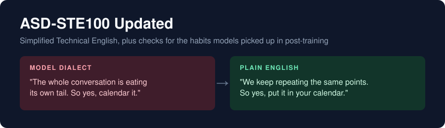

<p align="center">
  
</p>

<p align="center">
  <a href="LICENSE"></a>
  <a href="https://arxiv.org/abs/2610.29162"></a>
  <a href="https://news.ycombinator.com/item?id=50223647"></a>
  
  
  
  
  <a href="https://github.com/danyuchn/asd-ste100-skill"></a>
</p>

# ASD-STE100 Updated

This is an agent skill. It makes model output easy for people to read. It has two parts:

1. **Simplified Technical English (STE).** [ASD-STE100](https://www.asd-ste100.org/) is the controlled English that the aerospace industry uses so that nobody can misread a maintenance manual. This part is the [asd-ste100 skill by Dustin Yuchen Teng](https://github.com/danyuchn/asd-ste100-skill). Its text is not changed.
2. **Model dialect habits (new).** This part adds six checks. They find sentence forms that post-trained models (models with extra training for chat, code and reasoning) use too much. Each form saves tokens but makes the reader work harder.

## Contents

- [Why this exists](#why-this-exists)
- [The six model dialect habits](#the-six-model-dialect-habits)
- [Install](#install)
- [Use](#use)
- [What comes from upstream](#what-comes-from-upstream)
- [Limits](#limits)
- [Credits and license](#credits-and-license)

## Why this exists

The six checks come from a paper by Clark, Martin and Mahowald (NYU and UT Austin, October 2026). Its title is [Why is AI-generated language so hard to understand?](https://arxiv.org/abs/2610.29162). They measured text from 14 models. These are their main results:

- **Models use more hard-to-read forms than people do.** The authors tested nine frontier models (the newest and most capable models). All nine used more "human verb on a thing" phrases than human text of the same type. All nine also used more rare word pairs.
- **Post-training is the likely cause.** Base models (models with pretraining only) were close to human text. Olmo is a family of open models from the Allen Institute for AI. In this family, the effect grew at each step: base model, then instruct model, then reasoning model.
- **Long sessions may make it worse.** The effect was larger in multi-turn chat and coding sessions than in single essays. The authors think that the many turns are the reason.
- **Length penalties can cause it.** The authors trained a small model with RL (reinforcement learning, training by reward) and a penalty on length. The model began to always pick the shorter form of a sentence. It also did this in some sentence forms that it did not see in training.
- **Models can improve.** Claude Opus 5.5 used fewer hard-to-read forms than Opus 5 on 19 of 21 measures.

The authors name the problem. They give no fix for users. In [the Hacker News thread](https://news.ycombinator.com/item?id=50223647), several people said that one prompt helps: tell the model to write in ASD-STE100. This skill does that. It also adds the forms from the paper as a checklist.

## The six model dialect habits

| Habit | Model writes | Plain English |
|---|---|---|
| Human verbs on things | "This asymmetry bites." | "This asymmetry causes wrong results." |
| Nouns used as verbs | "So yes, calendar it." | "So yes, put it in your calendar." |
| Dropped "that" | "a first name he'd never hear anyone use" | "a first name that he would never hear anyone use" |
| Invented phrases | "verified red against the original source" | "checked that the test fails on the original code" |
| Long gaps | "A cat who can always get up and away is a much calmer cat." | "A cat is much calmer when it can always escape." |
| Verbs with no object | "The form submits." | "The form sends the data." |

The examples in the first five rows are quotes from the paper. The example in the last row comes from the Hacker News thread.

The skill tells the model to write a draft first. Then the model checks the draft against this list and fixes each problem that it finds. One commenter in the Hacker News thread said that this works better than a ban before writing. A likely reason is that the habits come from training, so a ban alone does not remove them. The habits may also come back as a session grows. For this reason, the skill tells the model to check again in long sessions.

## Install

**Claude Code**

```sh
git clone https://github.com/atharva-2001/asd-ste100-updated ~/.claude/skills/asd-ste100-updated
```

**Codex CLI**

```sh
git clone https://github.com/atharva-2001/asd-ste100-updated ~/.codex/skills/asd-ste100-updated
```

**Other agents.** Put `SKILL.md` in the system prompt, or tell the agent to read it before it writes.

## Use

Call the skill by name, for example `/asd-ste100-updated`. You can also ask for a "plain-language rewrite" or an "STE100 rewrite". The skill returns only the rewritten text. Ask "show the diff" to get a table of each rule that the text broke.

The repo has a linter (a script that finds rule breaks). It checks the structural STE rules, and it uses only the Python standard library:

```sh
python3 scripts/ste-lint.py README.md
python3 scripts/ste-lint.py --json < draft.txt
python3 scripts/ste-lint.py --selftest
```

The linter does not check the six model dialect habits yet. The model checks them.

## What comes from upstream

These files are from [danyuchn/asd-ste100-skill](https://github.com/danyuchn/asd-ste100-skill) v0.4.0, with no changes:

- `scripts/ste-lint.py`, the structural linter
- `references/writing-rules.md`, a summary of the 53 STE writing rules
- `examples/`, before and after examples, and linter edge cases

This fork changes these parts:

- the "Model dialect habits" section in `SKILL.md`
- the skill name, the description and the version
- this README, the banner and the Codex metadata in `agents/openai.yaml`

## Limits

- **No human reading test.** The authors link each habit to reading difficulty through older psycholinguistics studies (studies of how people process language). They did not test people on model text.
- **A small causal test.** The authors ran the length penalty test on a 1.5B model (1.5 billion parameters) and one narrow task. The test shows that the effect can happen. It does not show that frontier training caused it.
- **English only.** The paper and this skill cover English only.
- **No official STE dictionary.** ASD does not let most other parties copy its approved word list. The skill uses the rules and prefers plain words. It does not claim STE compliance.

## Credits and license

- STE skill and linter: [Dustin Yuchen Teng](https://github.com/danyuchn/asd-ste100-skill), MIT.
- Model dialect habits: from [Clark, Martin and Mahowald (2026)](https://arxiv.org/abs/2610.29162). The skill states each habit in its own words.
- ASD-STE100 is a standard of the [AeroSpace and Defence Industries Association of Europe](https://www.asd-ste100.org/).

MIT license. See [LICENSE](LICENSE).
